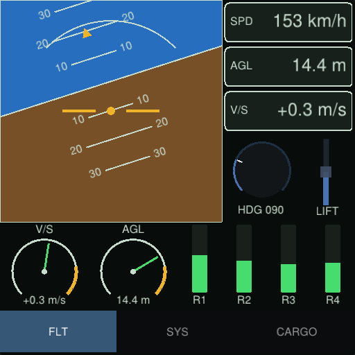

# Monstro

[](https://github.com/bholcomb/monstro/actions/workflows/build.yml)

**An immediate-mode GUI for C and C#, themable down to the pixel and drawn by
any renderer: from editor tool windows to in-game cockpit screens.**

You describe the UI in code every frame. Monstro hands back vertices, indices
and draw commands, and your renderer draws them, to the screen or onto render
targets.



## Example

```c
#include <monstro.h>

/* Your renderer provides these two. */
uint64_t upload_texture(const MonstroTextureData* pixels);
void render(const MonstroDrawData* draw);

static float throttle = 0.5f;
static bool lights = true;

void run(void)
{
    MonstroEnv* env = monstro_init(NULL); /* fonts, themes and the atlas, shared by every UI */
    monstro_font_load_ttf_from_file(env, "sans", "DejaVuSans.ttf", 16.0f, 32, 96);
    MonstroTextureData atlas = monstro_env_get_atlas(env);
    monstro_env_set_atlas_texture(env, upload_texture(&atlas));

    MonstroContext* ctx = monstro_context_create(env, NULL); /* one UI */
    monstro_context_set_theme(ctx, monstro_theme_find(env, "dark"));
    monstro_set_display_size(ctx, 1280.0f, 720.0f);

    while (running) {
        monstro_set_mouse_pos(ctx, mouse_x, mouse_y);
        monstro_set_mouse_button(ctx, MONSTRO_MOUSE_BUTTON_LEFT, mouse_down);

        monstro_begin_frame(ctx, dt);
        if (monstro_begin_window(ctx, "Engine", NULL, MONSTRO_WINDOW_DEFAULT)) {
            monstro_label(ctx, "Main drive");
            monstro_slider_float(ctx, "Throttle", &throttle, 0.0f, 1.0f, "%.2f", NULL);
            monstro_checkbox(ctx, "Running lights", &lights, NULL);
            if (monstro_button(ctx, "Launch", "Leave the dock"))
                launch();
            monstro_end_window(ctx);
        }
        render(monstro_end_frame(ctx)); /* vertices, indices and draw commands */
    }

    monstro_context_destroy(ctx);
    monstro_shutdown(env);
}
```

A theme of your own starts from a built-in one:

```c
MonstroStyle style;
monstro_style_set_dark(&style);
style.window.rounding = 6.0f;
style.button.normal.type = MONSTRO_STYLE_ITEM_COLOR;
style.button.normal.data.color = monstro_color_rgb(0.1f, 0.5f, 0.3f);
style.button.hover.type = MONSTRO_STYLE_ITEM_SPRITE; /* or an image or a nine-patch */
style.button.hover.data.sprite = (MonstroSprite){skin_texture, {0.0f, 0.0f}, {0.25f, 0.125f}};

MonstroTheme* hud = monstro_theme_register(env, "hud", &style);
monstro_context_set_theme(left_screen, hud); /* any number of UIs share a theme */
monstro_context_set_theme(right_screen, hud);
```

In C#:

```csharp
using Monstro;

using var env = new Env();
env.LoadFont("sans", "DejaVuSans.ttf", 16);
env.AtlasTexture = UploadTexture(env.Atlas);

using var ui = env.CreateContext();
while (running)
{
    ui.SetMousePosition(mouseX, mouseY);
    ui.SetMouseButton(MonstroMouseButton.Left, mouseDown);

    ui.BeginFrame(1280, 720, dt);
    if (ui.BeginWindow("Engine"))
    {
        ui.SliderFloat("Throttle", ref throttle, 0, 1);
        ui.Checkbox("Running lights", ref lights);
        if (ui.Button("Launch")) Launch();
        ui.EndWindow();
    }
    DrawData draw = ui.EndFrame();
    if (draw.Changed) Render(draw.Vertices, draw.Indices, draw.Commands);
}
```

## Why Monstro?

- **A C API with no hidden state.** One header, `monstro.h`, for C11 and C++17;
  every call names the environment or the UI it acts on.
- **Complete theming.** Three built-in themes and as many of your own, with a
  style for every widget type. Every widget's backgrounds, frames and cursors
  take a colour, an image, an atlas sprite or a nine-patch, so a theme can be
  artwork, with its own TrueType or bitmap font.
- **Any renderer.** Monstro never touches the GPU and ships no backend: draw
  its indexed, textured triangles with Vulkan, OpenGL, Direct3D, Metal or an
  engine's renderer, or have it write straight into your own vertex and index
  buffers. The examples render with Vulkan.
- **Many UIs at once.** One environment holds the fonts, atlas and themes; each
  UI (a screen, a panel, a tool window) is a lightweight context on it.
- **Widgets for tools and games.** Windows, menus, popups, tabs, trees, tables,
  text fields, a colour picker and a file dialog, plus cockpit controls:
  vertical sliders and bars, knobs, page tabs. A drawing API (shapes, curves,
  paths, rotated text and images) builds the rest: gauges, graphs, node
  editors.
- **.NET binding.** A .NET 10 binding with the whole C API, one to one, and a
  managed layer whose draw data is a zero-copy view of the native frame.

## Getting Monstro

Monstro is prebuilt for Linux x64, Windows x64 and macOS on Apple Silicon.
Each [release](https://github.com/bholcomb/monstro/releases) holds an archive
for each, with a `SHA256SUMS` file. An archive unpacks to one directory,
`monstro-<version>-<platform>/`, holding the public headers in `include/`, the
library and `LICENSE`:

| Platform | Archive | Library |
| --- | --- | --- |
| Linux x64 | `monstro-<version>-linux-x64.tar.gz` | `lib/libmonstro.so` |
| Windows x64 | `monstro-<version>-win-x64.zip` | `bin/libmonstro.dll`, and its import library `lib/libmonstro.lib` |
| macOS 11 or later, Apple Silicon | `monstro-<version>-osx-arm64.tar.gz` | `lib/libmonstro.dylib` |

For C and C++, add `include/` to the include path and link `libmonstro` from
`lib/` (on Windows, link `lib/libmonstro.lib` and ship `bin/libmonstro.dll`).
For .NET, reference
[`bindings/csharp/Monstro/Monstro.csproj`](bindings/csharp/Monstro/Monstro.csproj)
and put the library beside your app.

To build from source, see [docs/BUILD.md](docs/BUILD.md).

## Status

Monstro is young, and its API may still change before 1.0. Table sorting and
scrolling, and reorderable tabs, are declared in the API but not implemented
yet.

## Documentation

- [User guide](docs/GUIDE.md): the environment and context model, renderer and
  input integration, every widget, layout, theming and custom drawing.
- [C# binding](bindings/csharp/README.md): its two layers and how they map to
  the C API.
- [Examples](examples/): a widget tour, a cockpit display, and reusable
  components (console, node editor, plots, curve editor, timeline, property
  inspector, shortcut editor, toasts).
- [Building from source](docs/BUILD.md).

## License

[MIT](LICENSE)
